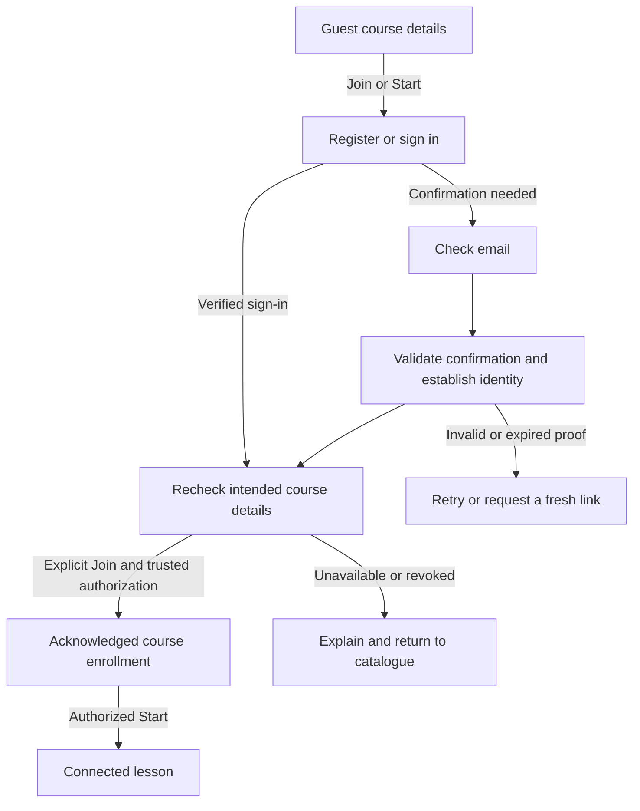

# Backend contract proposal

## Current planning checkpoint — 19 October 2026

The owner visually approved optional account onboarding (`752de75`) and learner sample-content polish (`f0b0792`). That approval does not establish native/device, accessibility, automated or connected-service verification. The next work is **LMS-B1: learner identity and course-admission planning**, extending this proposal rather than creating another contract or configuring services.

New owner decisions: **email verification is required before starting a connected course**; **signed-in, verified learners can join courses directly, while classes require an invitation**. Guest course browsing/details and optional onboarding remain the design direction. Registration, course enrollment, class membership and staff authority are separate concepts. These rules apply to future connected content; the existing guest sample lessons remain available.

The learner identity/course-access contract below is now drafted for review, including states, operations, data ownership, callback alternatives, failures and implementation slices. Its recommended defaults remain proposals; B1-05c/d are the confirmed product rules. Delivery/environment choices, authentic pilot content/authority and other register items remain unresolved. No migrations, providers, accounts or live services are configured by this document update.

## Historical checkpoints — 16 October

The older unanswered verification/admission notes below are superseded by B1-05c/B1-05d in the current decision register. Other unresolved policies remain open.

**16 October — auth follow-up UI scope:** Verification and new-password screens are explicitly reachable previews of future states; every service action remains unavailable. [Auth onboarding flow](auth-onboarding-flow.md) records the paths and backend considerations. No delivery method, code/token format, password policy, callback contract or verified-access gate is chosen. The question of requiring email verification before course access is unanswered; B1-05b remains open.

**16 October provider UI request:** Owner requested Google and Apple options from the account reference. Both now exist as unavailable screen actions on mobile sign-in/sign-up. Email/password self-onboarding remains confirmed. Provider setup, callbacks, email collision/account linking, verification and recovery behavior remain undefined and unconfigured; adding buttons does not establish a working OAuth service.

## Current contract proposal

Updated 19 October 2026. **Discussion draft; not an approved schema, API or permission implementation.** The owner selected adult learners, **self-onboarding with email and password**, screen prototypes before a connected pilot, and backend planning in parallel. Adults can register without a prior invitation. Verified learners join courses directly; classes require invitations. Administration means a system-wide super admin with evolving sub-admin roles. Supabase is planned, not configured or connected. Verification/recovery delivery and callbacks, staff sign-in, class invitation lifecycle and privileges remain to be agreed.

This document supplies a shared vocabulary for the learner app and teacher/admin proposals. It defines capabilities and data concepts rather than finished HTTP routes, SQL or a commitment to a separate API service. See [parallel delivery plan](parallel-delivery-plan.md) for task order and integration gates.

## Current implementation and contract boundary

Mobile email/password self-registration, sign-in and recovery have reference-based screen prototypes reachable through optional onboarding and Settings, including verification/reset previews. They validate fields and show service-unavailable outcomes; no identity provider, verification/reset delivery, policy consent or session exists. The signup name field does not update the learner profile; the separate optional name setup retains its device-profile behavior. The remaining B1-05b questions stay open and these screens do not constitute LMS-B3 implementation.

Teacher course/module authoring, structured lessons and automatic quizzes, preview/publication snapshots, class/enrollment examples and reports now have source prototypes. Administrator directory, scoped Access proposals, Settings and audit/operations examples also exist. Their state is session-only and does not establish real accounts, authorization, publication, invitations or audit history.

Mobile now groups four stable sample lesson IDs into one course with two modules. Home, Lessons, curriculum and quiz results derive a course journey from the existing lesson store. Quiz completion, reading position and best score remain distinct. The sample course is not a publication produced by the teacher workspace. A connected adapter must never treat either prototype's fixtures as authoritative records.

## Minimal entity relationships

| Concept | Relationship and proposed minimum responsibility |
| --- | --- |
| Auth identity and profile | An authenticated adult has a stable identity and display profile. Adults self-register with email/password and must verify email before connected course start (owner selected 16/19 October); delivery/recovery/callback, staff sign-in and staff-as-learner rules remain decisions. Self-registration does not establish class membership or a staff grant |
| Course enrollment | A verified learner directly joins an available course independently of class membership (owner selected 19 October). The trusted enrollment operation checks session, verified status and course availability; release binding, repeat-join, withdrawal and revocation details remain contract proposals |
| Organization, class and membership | An organization contains classes; an identity has explicit class memberships. Membership records distinguish learner participation from assigned teacher responsibility and track active/revoked state |
| Scoped role grant | A staff identity receives an explicit capability set and scope from an authorized grantor. The system super-admin bootstrap and sub-admin grant/delegation rules must be agreed before implementation |
| Invitation | Refers to an intended class/membership and, if required, recipient identity. Expiry, redemption limits, revocation and grant authority are enforced by a trusted operation |
| Course, module and course release | Stable course/module identities organize ordered lesson references. Teacher authoring and a sample mobile curriculum exist. Proposed immutable course releases bind ordered modules to exact published lesson versions; class availability refers to a release, never a mutable draft. Release promotion, withdrawal and existing-learner rules remain decisions |
| Lesson and lesson version | A stable lesson has editable draft content and immutable published versions containing ordered sections, questions and scoring rules. Class availability points to an allowed published version |
| Quiz attempt and submitted answers | An attempt belongs to one authenticated learner and one published version; its submitted answers produce a trusted score and completion outcome. No synthetic attempts are created from sample summaries |
| Reading progress and bookmark | Per-learner records refer to lesson identity; reading position also identifies the applicable version/section. Completion derives from accepted attempts, not merely opening the last section |
| Audit event | Records agreed privileged actions with actor, action, target, outcome and authoritative time. Retention, readership and sensitive-field redaction remain to be defined |

Media ownership/access can be attached to lesson versions when images enter the pilot. Do not add unrelated profile, analytics or content entities before a concrete workflow requires them. Published content access and private draft access are separate permissions.

## Shared contract rules

- Use stable opaque identifiers; the authenticated principal comes from the validated session, never a client-supplied owner or role assertion.
- Responses distinguish available data, empty results and unavailable/error states. A transport success alone must not be interpreted as a durable mutation unless the operation acknowledges acceptance.
- Proposed failure vocabulary: `unauthenticated`, `verification_required`, `forbidden`, `not_found`, `validation_failed`, `conflict`, `expired`, `rate_limited` and `temporarily_unavailable`. Define safe error details, retry guidance and a diagnostic identifier where appropriate; avoid leaking restricted resource existence.
- Server-controlled timestamps describe server events. Client times may be diagnostic input but cannot establish trusted completion or audit history.
- Reads return only authorized fields. The owner confirmed automatic knowledge checks: show the correct answer and explanation after the learner checks a response, with no teacher review. Define the trusted feedback operation and version binding before connected work; initial question payloads need not expose unchecked answers. These are learning interactions, not proctored examinations.
- List operations need explicit ordering and bounded pagination when the dataset warrants it. Empty pages are not an authorization failure.

## Capability proposals

| Consumer / capability | Request concepts | Response concepts and important failures |
| --- | --- | --- |
| Adult: self-register | Email, password and agreed minimal profile fields through the configured identity service; no caller-selected privileged role | Safe registration/verification state and next step; validation, rate limiting or temporary failure. Account creation is separate from class admission and staff grants; exact verification, duplicate-account messaging and recovery behavior remain to be agreed |
| Guest/mobile: browse course catalogue/details | Publicly visible course summary/identifier; no assumed session or membership | Public description and permitted curriculum summary only; no private drafts, answer keys, restricted class data or implied enrollment. The exact public fields need agreement |
| Mobile: join an available course | Validated verified identity and available course identifier; no caller-selected class/staff grant | Acknowledged own course enrollment and allowed next destination, or verification required, unavailable course, conflict or temporary failure. Repeat-join semantics and release binding need agreement |
| Mobile: open connected course curriculum | Verified session, authorized course enrollment or separately permitted class access, and course release identifier | Ordered modules with exact lesson/version references and permitted lesson summaries; unavailable release, lost access or failed load. Class membership must not be inferred from course joining |
| Mobile: open connected published lesson | Verified session, authorized course/class context and lesson/version identifier | Authorized lesson content/version; unavailable publication, lost enrollment/membership or expired session. Guest sample content remains a separate source |
| Mobile: save reading position/bookmark | Lesson/version, valid section or desired bookmark state, optional revision token | Acknowledged current state/revision; invalid section, stale version, lost access or temporary save failure |
| Mobile: check a quiz answer | Authorized published version, question ID and selected choice | Automatic correct/incorrect feedback, correct answer and explanation for that version; invalid question/choice, revoked access or unavailable version. Checking one answer is not final attempt completion |
| Mobile: submit quiz attempt | Published version, answers keyed by question, unique submission key | Accepted attempt ID, trusted score/completion and permitted feedback; incomplete/invalid answers, unavailable version, duplicate-key conflict, revoked access or uncertain network outcome |
| Mobile: read progress/results | Current session and authorized lesson scope | Genuine completion/best-score summaries; attempts only if that view is agreed. No results is distinct from a failed load |
| Teacher: create/update draft | Authorized destination scope, draft content, expected draft revision on update | Draft ID and new revision with validation details; forbidden destination, invalid content or concurrent-edit conflict |
| Teacher: preview/publish | Draft ID/revision and intended class visibility | Preview of the proposed version; on publish, acknowledged immutable version and availability. Reject stale draft, invalid quiz/content, missing rights/access or conflicting publication |
| Teacher: publish course release | Course revision, ordered module/lesson references, reviewed lesson revisions and permitted destination | Atomic acknowledged release snapshot or conflict/validation error. No partly published course; publication is separate from making a release available to a class |
| Staff: assign/replace class course release | Authorized class, immutable release ID, expected assignment revision | Acknowledged assignment revision and explicit availability; reject withdrawn release, stale revision or unauthorized class. Existing learner/version handling requires an agreed policy |
| Teacher: read class completion | Assigned class, permitted lesson/version scope, bounded paging | Authorized roster/result summary with explicit denominators; empty class, unavailable result or assignment revoked. No invented hours/streaks/history |
| Staff: issue/revoke invitation | Permitted class/membership, agreed recipient/expiry constraints | Invitation state and safe delivery/redeem information; invalid scope, expired/revoked invitation or insufficient grant authority |
| Mobile: redeem invitation | Validated session and invitation proof | Acknowledged membership or safe existing-member outcome; invalid, expired, revoked, exhausted or wrong-recipient invitation |
| Admin: manage roles/scopes | Target identity, explicit capability/scope, expected current grant revision | Authorized grant/revocation outcome and audit reference; delegation denied, invalid scope, stale grant or protected bootstrap-account rule |
| Admin: inspect system operations/audit | Explicit permitted view and bounded filters | Minimal operational records and permitted audit fields; unknown capability denied. System visibility does not imply unrestricted learner-answer access |

## Published versions and reliable submissions

1. Editing a published lesson creates a new draft/version; it does not mutate the version attached to an existing attempt. Validate question IDs, answer options, scoring rules and class visibility before publication.
2. The learner submits the version they actually saw. Decide whether an already-open older version remains submit-able after a replacement is published, and what unpublishing or membership revocation does to that submission.
3. The client creates one submission key per intentional attempt and reuses it when retrying an uncertain request. Scope uniqueness to the authenticated learner; bind the key to the version and normalized answer payload.
4. Repeating the same key/payload returns the original accepted outcome without creating a second attempt. Reusing a key with different content returns a conflict; a deliberate new attempt uses a new key.
5. A trusted transaction validates authorization/version/answers, computes the score, records the attempt and updates the derived progress outcome atomically. Proposed best score uses the maximum accepted score, including a real zero; confirm rules for retries and lesson-version changes.
6. The mobile UI distinguishes pending/uncertain submission from acknowledged completion. Preserve enough pending state to retry safely; reconciliation, expiry and supported offline behavior require an explicit policy before release.

The sample app currently completes a lesson after any fully finished quiz, with no passing threshold. Preserve that as a candidate rule for discussion, not an implicit production decision. Existing sample progress lacks complete answers/timestamps and cannot be converted into authentic attempt history.

## Course release and progress proposal

These are reviewable candidate rules, not production decisions:

1. A course draft contains ordered modules and lesson references. Preview identifies the exact draft revisions reviewed. Publishing verifies all referenced content, questions, media readiness and authority before committing one immutable release snapshot. Concurrent edits return a conflict; the client reviews the changed content instead of silently overwriting it.
2. A class-course assignment identifies a release. Reordering a draft does not reorder an assigned release. Adding/replacing a lesson produces another release; whether existing learners stay pinned or move is an owner decision. Withdrawal, revoked membership and in-flight attempts require explicit rules before enabling submissions.
3. Curriculum reads return release/module/lesson/section identifiers, not positional IDs derived from list indexes. Connected reading position is bound to the version and stable section ID; a missing section requires a visible restart/remap choice, never a silent index carryover.
4. Proposed lesson completion is an accepted, fully submitted automatic quiz without a passing threshold; retries are allowed and best score is the highest accepted score **within the same lesson version**, including zero. These mirror current learning intent but still need production agreement. An updated version must not inherit an old-version completion by accident.
5. Proposed course summary counts distinct required lesson-version references in the assigned release. Duplicated lesson placement must not inflate the denominator; publication should reject duplicate placement until reuse semantics are agreed. Empty releases cannot be published. A summary states its release ID, numerator/denominator and data availability; unknown progress is not a recorded zero. Required/optional lessons are not implemented and need an explicit rule if introduced.
6. Reading progress and bookmarks are not completion evidence. The current sample resume policy is started unfinished lessons in curriculum order, then first unfinished; no recency timestamp exists. Preserve that as a simple candidate without inventing last-activity history.
7. Existing `sundayseeds.learning.v1` data has no authenticated owner or published-version proof. Default proposal: keep it isolated as sample learning; do not import it into trusted attempts, class reports or audit events. Any future transfer is an explicit, owner-approved migration with clear limits, never an automatic account merge.

## Operations and integration boundaries

| Prototype action | Connected responsibility to agree and implement |
| --- | --- |
| Directory classifications and invitation examples | Profile labels do not grant access. Trusted memberships, invitation expiry/recipient/redemption and teacher assignment must be validated together; delivery failure is distinct from invitation creation |
| Role proposal and assignment-review snapshots | Saving a proposal must not activate grants. Trusted grant operations validate the grantor's current authority, reviewed revision and scope in one transaction. Editing a role does not silently broaden existing grants; revocation/history and concurrent last-admin protection need server rules |
| Settings defaults | New-form prefills are client preferences unless explicitly approved as durable scoped defaults. Help text/table density are not security policy. Policy changes cannot be smuggled through general Settings saves |
| Audit/service examples | Fictional fixtures never become audit records. Trusted operations produce redacted events with authoritative outcome/time and a diagnostic reference. A client cannot assert success, healthy services or restore completion; readership, retention and operational checks remain decisions |
| Automatic answer feedback | Knowledge checks provide correct answers/explanations without teacher review. Bind feedback and submission to the same immutable question version; do not trust a client-calculated score |
| Uncertain save or submission | Use acknowledged revisions and idempotent submission reconciliation. Never repeat an attempt with a new key solely because a response timed out. Session/account changes isolate caches and pending writes by authenticated identity |

No SQL, RLS policies, provider configuration, credentials, email delivery or network calls are introduced by this proposal. LMS-B2 must implement only the subset approved through the decision register below.

## Decision register for the connected pilot

| ID | State | Decision or concrete question | Blocks |
| --- | --- | --- | --- |
| B1-01 | Confirmed by owner | Adult learners; system-wide super admin and evolving sub-admin structure | Product scope established; capabilities remain open |
| B1-02 | Confirmed by owner, 16 October | Adult learner sign-in: email and password | Provider/verification/recovery configuration still pending |
| B1-03 | Confirmed by owner | Automatic knowledge checks with answers and explanations; no teacher marking | Feedback operation implementation |
| B1-04 | Owner decision required | First organization/class, curriculum owner, content/translation rights and permitted publisher/inviter | Real pilot data and content publication |
| B1-05a | Confirmed by owner, 16 October | Adult learner self-onboarding: create an account without an invitation using email/password. Class admission and staff grants are separate | Registration UI/contract direction established; no service configured |
| B1-05b | Remaining owner/contract decisions required; verification/admission direction settled in B1-05c/d | Verification/recovery method and destination, safe errors/retry/password/session policy, class invitation recipient/expiry/redemption lifecycle; staff sign-in and staff-as-learner support | Remaining identity/enrollment workflow and connected implementation |
| B1-05c | Confirmed by owner, 19 October | Learners must verify their email before starting a connected course. Guest browsing/details remain available; existing sample learning is unchanged | Enforce verified identity at trusted connected course Start/Join/content operations; delivery/callback contract still pending |
| B1-05d | Confirmed by owner, 19 October | Signed-in, verified learners join courses directly; class membership requires an invitation. Joining a course does not create class membership or staff authority | Separate course enrollment and class invitation contracts; trusted availability/scope/lifecycle enforcement |
| B1-06 | Owner decision required | Super-admin bootstrap/backup/recovery, initial sub-admin capabilities/scopes, delegation and audit readers | Production grants/administrative authorization |
| B1-07 | Proposal above; not accepted | Immutable course releases, class assignment pinning, withdrawal/revocation and older in-flight attempts | Schema and publishing/learning services |
| B1-08 | Proposal above; not accepted | Completion without pass threshold, unlimited retries, version-bound best score and course denominator | Trusted attempts and reporting |
| B1-09 | Owner decision required | Media ownership/access, retention/deletion/export, backup owner and supported offline/retry behavior | Storage and release readiness |
| B1-10 | Proposed isolation; not accepted migration policy | Keep sample progress separate; determine whether any explicit transfer is wanted | Learner integration/account-switch behavior |

An agent may refine proposals and adapters' conceptual boundaries while these questions are open. It must not mark them accepted, invent pilot identities, configure production access or import fixtures. Record each owner answer here and propagate it to the implementation plan and ignored handoff.

## Learner identity and course-access contract

Draft v1, 19 October 2026. This completes the focused planning deliverable; it is not a frozen schema or permission to implement/configure services. The operation names below are feature contracts, not promised HTTP endpoints. Confirmed product rules remain B1-02/05a/05c/05d. Everything labelled recommended or proposed requires review before its slice starts.

### Recommended defaults to review

| ID | Proposed default | Why / remaining choice |
| --- | --- | --- |
| ID-01 | Email confirmation and password-recovery links, with an owned HTTPS landing page and an explicit confirmation action before proof consumption | Recommended for email opened on another device and prefetching mail clients. Requires a domain, hosting and proof/session handling design; PKCE-only same-device callbacks are an alternative below. No OTP entry UI is assumed |
| ID-02 | Email/password plus optional display name only; retain the existing 40-character name limit and whitespace normalization | No date of birth, address, interests, avatar upload or class/staff role field. Device name can be explicitly offered for reuse, never silently copied; blank account name is valid |
| ID-03 | Minimum 15-character passphrase, spaces/paste/password managers allowed, no silent trimming or truncation | Recommendation, not current form behavior or configured policy. Provider maximum/byte behavior and any additional checks must be confirmed and mirrored in signup/reset validation before enabling them |
| ID-04 | One active account per app installation; normal Settings sign-out targets this device/session explicitly | Clear account data locally; distinguish uncertain remote revocation. Do not silently use the SDK's broader default sign-out scope |
| ID-05 | After successful password reset, clear the recovery context and require a fresh sign-in; request revocation of existing sessions | Report password-change success separately from revocation failure. Exact other-session policy remains to approve; do not promise immediate token invalidation |
| ID-06 | An invitation is recipient-email-bound, single-use, expires after seven days, and initially admits a learner only | Proposed invitation policy, not implied by invitation-only classes. Issuer authority, reissue/revocation and staff invitations remain separate decisions |
| ID-07 | One pending public course intent per installation, expiring after 24 hours; return to its details for an explicit Join/Start | Safe default avoids automatic enrollment on an email click. Only public course ID, intended action and creation time; no arbitrary redirect, password or invitation proof |
| ID-08 | Keep sample progress separate and account progress initially empty; do not upload or invent attempts | Existing fixture isolation continues regardless. This is a proposed account migration policy under B1-10, not yet approved |

No project, region, domain, sender, provider plan, support mailbox or staff identity is inferred. They are deployment inputs to supply before configuration; public terms/privacy and account lifecycle requirements also remain open.

### Identity and access states

These describe application state, not new provider roles. The adapter reports authoritative facts plus availability, not a client-selected `verified` flag. The proposed Supabase flow requires **Confirm Email enabled in every connected target environment**, including local/staging; do not rely on defaults or allow auto-confirmation to stand in for email proof. This normally gates password sign-in as well as course access, while guest browsing remains available. Signup may have no usable session; a returned user record alone is not authenticated access. A future unverified-login design would need explicit review rather than disabling confirmation and treating auto-confirmed identities as proven. See [password authentication](https://supabase.com/docs/guides/auth/passwords).

| State | Meaning and available actions | Connected course access |
| --- | --- | --- |
| `initializing` | Restore/validate identity; show loading rather than another account's cached profile. Guest public/sample views remain independently usable | Paused |
| `guest` | No authenticated identity; browse public catalogue/details, use bundled samples, sign in/register | Join/Start requires identity |
| `confirmation_pending` | Signup/resend request accepted with neutral messaging; may have no session. Keep only transient form context needed for retry/resend | Denied; no public email-verification lookup |
| `session_unverified` | A validated provider session exists but trusted verified-email evidence is absent | Denied, including direct API access |
| `session_verified` | Validated identity and verified email; profile may independently be loading, missing or failed | Join available courses; class content needs its own authorization |
| `recovering` | Recovery proof exchange/password-update flow; existing account differences require explicit account replacement | No automatic enrollment/learning navigation; this state does not invent a restricted provider role |
| `session_unavailable` | Session validation/refresh cannot complete, for example due to a network failure | Pause connected reads/writes; do not erase a session merely because the network is down |
| `session_expired` | Provider confirms identity is no longer usable | Hide account-owned data, pause writes and offer sign-in; preserve independent guest samples |

Cancel/Skip clears the pending course intent and returns to safe browsing/account entry. Preserve any existing valid identity unless the learner explicitly signs out or approves account replacement; cancellation alone never logs that identity out. Guest onboarding still does not require an account. Email confirmation alone never grants a course/class/staff record. An authenticated profile failure is shown as profile unavailable, not a failed registration or zero learning activity.

### Conceptual data and authority

These are proposed records/fields, not SQL. IDs and timestamps come from trusted services; all account-owned requests derive the actor from the validated session.

| Record | Minimum contract fields | Authority and lifecycle |
| --- | --- | --- |
| Auth identity/session | Provider user ID, own email, trusted email-confirmed evidence, current session availability | Provider-managed; password hashes/tokens never enter an application profile table. Screens receive a safe identity summary, not refresh tokens |
| Own account profile | `user_id`, nullable `display_name`, server `revision`/`updated_at` | Own read/update only; display name is presentation. Provision idempotently after validated identity; a missing profile can retry without registering again. Client-editable metadata cannot grant roles or verification |
| Public course offering | Stable course ID, published title/summary/topics, estimated reading time, module/lesson counts, join availability | Explicit public projection only. Draft text, private class names/rosters, learner progress and answer keys are excluded. Publisher/content rights and release availability require B1-04/07 |
| Course enrollment | Enrollment ID, learner ID, course ID, acknowledged state and agreed release reference | Separate from class membership. One current enrollment per learner/course; repeat join returns it, concurrent joins do not duplicate it. Revoked enrollment is not silently reactivated |
| Class invitation | Invitation ID, intended class/learner participation, intended verified recipient, hashed proof, authoritative expiry/revocation/redemption | Trusted issuer only. Raw proof is sensitive and never stored in ordinary route state, analytics or public course intent. Proposed seven-day/single-use rules await ID-06 approval |
| Class membership | Membership ID, identity ID, class ID, active/revoked state and revision | Created only by trusted accepted invitation for this slice; no caller-selected teacher/admin grant. Teacher assignment requires separate authority rules |
| Pending course intent | Public `course_id`, `action` (`join` or `start`), `created_at` | Untrusted navigation context under proposed ID-07; never an entitlement. Keep outside account results; clear on cancel/sign-out/account switch/expiry, not ordinary successful continuation of the same authentication flow |

Never authorize using profile names or user-editable metadata. Trusted course/class operations check current enrollment/membership and publication state; stale token claims cannot stand in for current revocation checks. These boundaries follow [Supabase RLS guidance](https://supabase.com/docs/guides/database/postgres/row-level-security); concrete policy SQL and restricted function permissions belong to the implementation slice.

Release pinning/version replacement is still B1-07, not settled by this table. Until it is approved there is no connected enrollment schema or content integration to implement. Class membership also does not silently enroll someone in independently offered courses: class-assigned content rules need their own approved release/access mapping.

### Feature operations and acknowledgement

The common envelope is either an acknowledged outcome or a typed failure with safe message, retryability and optional diagnostic reference/retry-after. Raw provider errors are normalized in the data adapter; secrets never enter that envelope. Outcomes can be action-required or uncertain; `200`/resolved promise is not synonymous with delivered email, enrollment or saved progress.

| Operation | Request concepts | Acknowledged outcome / important failures |
| --- | --- | --- |
| Register identity | Email, password, optional normalized name; environment-owned callback purpose | `check_email`/next action after accepted request, or validation/rate-limit/service failure. Do not report a new account/session merely from a returned user record; duplicate outcomes use safe messaging |
| Sign in | Email/password to identity adapter | Validated identity/session summary, or `invalid_credentials`, trusted confirmation-required outcome, rate limit or temporary failure. Wrong password and unknown account share ordinary failure copy; no preflight email-existence lookup |
| Request confirmation again | Transient email context or supported authenticated identity | Accepted request with neutral copy and provider retry-after; no delivery guarantee and no caller-selected callback URL |
| Complete email proof | Purpose-bound proof handled only by the dedicated callback boundary | Validated provider outcome; establish/revalidate identity or offer sign-in. Invalid/expired/replayed/wrong-purpose proof never sets verified state |
| Check current verification | Existing validated session, if present | Revalidated own identity; with no session, offer sign-in/open-link instructions rather than querying verification for an arbitrary email |
| Request recovery | Email plus approved recovery purpose/destination | Neutral eligibility message on acceptance; network/rate-limit/service failure remains a failure. Unknown email must not be disclosed |
| Update recovered password | Valid provider recovery context plus new password | Password change acknowledged separately from sign-out/revocation outcome. Invalid proof/session, validation, rate-limit or uncertain update shows retry/reconciliation guidance; opening the existing reset preview route is not proof |
| Ensure/read own profile | Validated identity only | Existing/created own profile, or `profile_pending`/load failure. Auth success persists even if profile provisioning fails; retry the profile operation, never duplicate signup |
| Update own display name | Normalized name and expected profile revision | Acknowledged profile/revision, validation, conflict or unavailable save. Preserve typed input on failure; no role/email/membership fields accepted |
| Join course | Course ID plus session context; no learner ID/role/class grant | Atomic verified-identity/current-availability check; `joined` or `already_joined` with same enrollment ID and agreed release reference. Verification required, unavailable, revoked or temporary failure does not create enrollment |
| Open/Start connected content | Authorized enrollment or agreed class access, course/release/lesson ID | Allowed version/content or safe verification/session/access/publication failure; a known lesson ID or stale local enrollment is insufficient |
| Redeem class invitation | Sensitive invitation proof plus validated intended identity | Atomic membership result; proposed recipient/expiry/single-use checks. Same accepted actor retry can return current membership, but never restore revoked membership. Wrong identity/used/expired/revoked proof returns safe unavailable guidance |
| Sign out | Explicit approved session scope | Local identity/data teardown and separate remote revocation outcome. No accidental global sign-out; uncertainty must not display another identity's cached data |

JoinCourse uses its learner/course uniqueness to reconcile double taps, concurrent requests and an unknown response. Re-read the same operation/current enrollment; do not create another record or automatically reactivate a revoked one. If the session changes while a request is in flight, discard its UI/cache result for the new identity; any acknowledged prior-identity mutation remains that identity's record.

For invitation retries, an already-redeemed proof is not a new reusable grant: only the recorded redeemer may receive a safe already-member result, and only current active membership permits access. A different actor gets no recipient/membership disclosure. Delivery failure, invitation creation and membership acceptance are separate outcomes. Issuer/admin authority remains outside the learner contract until B1-04/06 is agreed.

### Callback and email-delivery proposal

Recommended ID-01 is an owned HTTPS landing flow: open an email link → display the purpose → explicit confirmation → validate/consume the purpose-bound proof → show the acknowledged result. No proof consumption on an initial page GET. A token hash is a sensitive one-time bearer credential, not an ordinary public identifier. Proof-bearing query values must be redacted from application/access logs and analytics, removed from browser history after handoff, and excluded from arbitrary redirects/referrers. The callback host needs its own safe session, CSRF/account-binding and replay design before implementation. This recommendation is an inference from [Supabase's email-template/token-hash and prefetch guidance](https://supabase.com/docs/guides/auth/auth-email-templates), not a configured service.

Every proof exchange, including signup confirmation, can produce identity/session material. Isolate that result from an existing app/browser session until its subject is validated. A different identity requires explicit replacement approval before becoming the active account; preserve the prior identity on cancellation. Do not let confirmation for account B silently replace a signed-in account A. The same rule applies to recovery, even when the password reset finishes in another browser.

| Entry/result | Proposed behavior |
| --- | --- |
| Signup confirmation on the original device | Confirm through the trusted landing boundary. Then revalidate any current same-identity app session or sign in; return to the still-valid local course details without automatic joining |
| Email opened on another device/browser | Complete confirmation there; do not transfer its session/token to the native app through a URL. Return to the original app and sign in/revalidate normally. A pending course intent stays on the device that created it; no cross-device intent-sync promise |
| Recovery link | Dedicated recovery purpose/handler and provider-validated recovery context. Existing different-account session must be explicitly isolated/replaced before reset; never silently switch accounts. Password update needs proof/session, not just a typed matching password |
| Link invalid, already used, expired or wrong purpose | No success; offer sign-in or an explicit fresh request. Do not loop automatic resends or convert delivery uncertainty into a verified state |
| User cancels callback or returns without a result | Keep safe guest/account entry and explicit retry. Do not auto-enroll, clear valid sample data or infer success from the URL alone |

The alternative is a PKCE callback completed by the initiating app/browser. Supabase code exchange requires the original verifier, so an email opened elsewhere cannot transparently finish that exchange; overlapping flows also need coordination. If selected instead, define same-device instructions and restart/sign-in fallback before implementation. See [PKCE flow](https://supabase.com/docs/guides/auth/sessions/pkce-flow). Do not combine an implicit-token URL handler and PKCE exchange without a single reviewed strategy.

The existing `sundayseeds` scheme in `apps/mobile/app.json` is a starting point, not a callback contract or domain registration. Proposed logical purposes are signup-confirmation and password-recovery; actual HTTPS origin/path, native return destination, environment allowlists and host ownership are unresolved. No production URL is invented here. Use exact deployed redirect allowlists and validate any return destination against internal routes/public course IDs. Expo Go URLs are not native callback acceptance evidence; installed development/production builds must verify cold/warm linking. See [Supabase redirects](https://supabase.com/docs/guides/auth/redirect-urls), [native linking](https://supabase.com/docs/guides/auth/native-mobile-deep-linking) and [Expo SDK 57 Linking](https://docs.expo.dev/versions/v57.0.0/sdk/linking/).

Normal recovery acknowledgement copy is “If this address is eligible, check your email for the next step.” Registration uses equally neutral check-email/sign-in guidance when the provider intentionally obscures duplicates. Do not claim inbox delivery or account existence. Actual network, provider rejection or throttling remains explicit failure; resend buttons honor deployed retry-after/cooldown instead of silently repeating requests. Supabase's [password flow](https://supabase.com/docs/guides/auth/passwords) documents recovery's neutral account-existence outcome.

Real learner delivery requires an approved SMTP provider, sender/domain ownership, templates and environment configuration. Supabase's default sender is restricted to project-team addresses and intended for initial exploration; request acceptance is not a delivery receipt. See [custom SMTP](https://supabase.com/docs/guides/auth/auth-smtp). Exact expiry/rate settings, password limits and any plan-dependent protections must be verified against the selected project before configuration; no numeric provider defaults are promised by this contract. See [rate limits](https://supabase.com/docs/guides/auth/rate-limits) and [password security](https://supabase.com/docs/guides/auth/password-security).

### Profile, session and sample-data boundaries

- Guest display name remains under its existing device profile key. Proposed ID-02 permits explicit reuse for account registration only after a user action; opening signup/sign-in cannot silently replace the guest or account name. A signed-in learner sees the account's own profile; sign-out returns to the retained guest name and sample learning. Account-profile failure shows unavailable/retry, not another source's name masquerading as the account profile.
- Profile provisioning is idempotent and presentation-only. Existing account profiles are not overwritten by stale signup metadata or a device name. A missing profile and a failed read are distinct; concurrent writes use revisions and preserve edit buffers on conflict. Email changes, deletion/export, avatars and staff labels are outside the first profile-edit scope.
- The auth adapter alone owns provider tokens, refresh and persistence. Screens never save passwords/tokens or call the provider directly. Native credential-storage and web session/cookie strategy require a concrete deployment/storage review; ordinary sample AsyncStorage is not implicitly approved for credentials. Tokens/proofs and full sensitive callback URLs are redacted from logs, analytics and diagnostics.
- On bootstrap, validate the session before exposing account caches. Refresh network failure pauses connected actions without pretending to be a new guest or deleting recoverable credentials. Provider-confirmed expiry ends usable account access. Namespace data/pending writes by validated identity, and reject late responses using the initiating identity/session generation.
- Proposed ID-04 explicitly chooses local-scope normal sign-out. Tear down local identity, cached account/profile/content data and pending account mutations even when remote revocation is uncertain; never replay them under a later account. Preserve guest sample records. Supabase defaults to a wider sign-out scope and existing access JWTs can remain valid until expiry, so offline/global immediate revocation is not promised. See [sign-out behavior](https://supabase.com/docs/guides/auth/signout).
- Proposed ID-05 resets password only on provider acknowledgement, then clears recovery and requires sign-in. Session revocation is separately acknowledged; password changed/revocation uncertain is a recoverable partial outcome, not “password reset failed.” Current permission rows must enforce enrollment/class revocation independently of UI or cached claims.
- Sample lesson summaries contain no authenticated ownership, complete attempt answers or trustworthy attempt times. Retain their isolation; ID-08/B1-10 review cannot manufacture missing attempt history. Account switching never merges sample or account datasets automatically.

### Course return and class-invitation boundaries

Pending course intent is navigation only. Reject malformed/expired/unknown course IDs, external URLs, callback-provided role/identity fields and unapproved return routes. After successful auth, reload the public details and current eligibility, then require the explicit Join/Start action under proposed ID-07. Enrollment is acknowledged before navigating into connected content. If content disappeared or access changed, explain availability and return to catalogue. No automatic enrollment on signup, confirmation, password recovery or mere course-description opening.

A direct course join never adds class membership. An invite landing must not turn a caller-supplied class ID into access: the trusted proof identifies the class, recipient and participation. The pending invitation context is separate from public course intent and must use a reviewed protected handoff; raw proof is not placed in normal onboarding parameters. Invitation-only classes cannot be found by enumerating roster IDs or inferred from course enrollment. Any class-specific course assignment stays behind current membership and agreed publication rules.

### Proposed implementation slices and handoff

| Slice | Deliverable | Ready-to-start inputs / boundary |
| --- | --- | --- |
| Identity foundation — LMS-B2/B3 subset | Reviewed identity/profile shape, own-profile RLS/trusted provisioning, environment setup and provider adapter contract | Approve applicable ID-01–05 defaults, project/environment ownership, callback host/origins, sender, secure session strategy, password policy and exact implementation scope. No class/staff grants or fixture imports |
| Learner identity UI — LMS-B3/I3 subset | Real registration/sign-in, confirmation/recovery, profile, Settings session/sign-out and honest loading/errors | Foundation and callback/delivery paths verified by owner; replace explicit previews only as actual service outcomes become available. Preserve guest learning and optional onboarding |
| Public catalogue/course joining — LMS-B4/B5/I3 subset | Authorized public projection, trusted idempotent enrollment, course Start/content checks and safe return intent | B1-04 content/publisher ownership, B1-07 offering/release/version rules and ID-07 agreed; authentic course data, not teacher/sample fixture synchronization |
| Learner class invitations — LMS-B3 subset | Issue/delivery/redeem/revoke lifecycle and isolated membership access | Authorized issuer rules B1-04/06, ID-06, recipient/expiry/reissue/revocation and class-content policy agreed. Teacher/admin invitation/grants remain separately scoped |
| Connected learning/progress — LMS-B5/I3 | Trusted checked-answer feedback, version-bound submissions, reading/bookmarks and account reports | Release/completion/retry rules B1-07/08, lifecycle and B1-10 sample-transfer choice, idempotency and isolation agreed |

Implementation file boundaries follow the existing architecture: routes compose screens; auth/profile hooks call feature data adapters; one infrastructure client owns provider initialization. Future migrations/policy checks belong under the backend workspace only when that work starts. Do not create an empty shared contracts package or a general repository framework for this draft. The lead assigns exclusive file ownership before connected work; teacher/admin prototypes are not automatically connected by any slice.

### Planned acceptance evidence

None of these checks has run. Owner-run scenarios should record platform, input, acknowledged state and persisted outcome; web evidence never establishes native callback/accessibility coverage.

| Scenario | Required result |
| --- | --- |
| Guest / skipped onboarding | Public summaries and bundled samples available; direct connected Join/Start/content calls denied; no anonymous provider account is silently created |
| Signup, duplicate signup, resend and unknown recovery email | Safe consistent account-existence messaging; accepted request differs from rejected/throttled/uncertain request and does not claim delivery |
| Signup accepted with no session | Confirmation page works without an authenticated profile; Check verification does not expose an arbitrary email-status endpoint |
| Callback invalid/expired/replayed/wrong-purpose, prefetch GET, unexpected host/return URL | No consumed-on-GET success or unauthorized session/redirect; explicit retry path and no secret-bearing logs/history |
| Same-device and different-device confirmation/recovery; A signed in while B's link opens | Each supported strategy completes or gives its documented fallback; no token transfer in native navigation. Isolate B's confirmation/recovery result, require explicit account replacement and preserve A on cancellation |
| Account exists, profile creation/read/save fails | Auth success remains distinct; idempotent profile retry, preserved edit text and no second signup or stale-name overwrite |
| Unverified identity / client-spoofed verification or role | Trusted course checks deny access regardless of UI/profile/user metadata; registration grants no class/staff rights |
| Double-tap/concurrent/timeout course join | One acknowledged current enrollment; retries return its ID; hidden/withdrawn/revoked course state cannot be bypassed or silently reactivated |
| Return course expired/unavailable/changed identity | Reload/recheck details, explicit action and clear safe fallback; no auto-enrollment or carryover into another account |
| Invitation wrong recipient/expired/revoked/replayed/concurrent acceptance | Safe denial or own already-member result; one intended membership, no course/staff grant and no reactivation after membership revocation |
| Sign-out or account switch during read/save/join | Prior identity's UI/cache result rejected; no queued write replay under new identity; guest sample data retained; remote revocation uncertainty truthful |
| Password update succeeds but revocation acknowledgement fails | Report password changed and separate session/retry guidance; no false global logout or destructive password retry |
| Network loss/restart/expired session | Distinct loading/unavailable/expired states; no zero-as-missing data, cross-account cache display or fabricated saved progress |

### Review and next action

The reviewable contract is drafted. Next is owner review of ID-01–08 and the first slice's concrete environment inputs; these are recommendations, not confirmations added to B1-05c/d. Domain/sender/project/support ownership and published account policy documents must be supplied before configuration with real learners. B1-04/06/07/08/09/10 remain open for their corresponding content, privileged and lifecycle scopes. Approving this planning document alone does not create production resources or authorize broader services.

Actual work for this increment: existing source/config/doc inspection, official Supabase/Expo documentation review and independent contract review. No app change, dependency install, SQL/schema, provider configuration, email send, tests/builds, permission tests or runtime/native checks are part of this draft.

## Proposed permission matrix

“Proposed” means a boundary to approve and enforce in database policies/trusted operations. UI visibility is not enforcement. Deny by default; test both authorized and forbidden cases before claiming readiness.

| Capability | Adult learner | Assigned teacher | System super admin | Scoped sub-admin |
| --- | --- | --- | --- | --- |
| Read public course summaries | Allowlisted public projection; also available to guests | Same public projection | Broader unpublished views need a separate capability | Broader views denied until defined |
| Read/update own display profile | Own validated identity only; presentation fields cannot grant access | Own validated identity only | No impersonated profile writes | No impersonated profile writes |
| Join an independently available course | Verified own identity; no class/staff grant | Only through separately valid learner access | No impersonated enrollments | No impersonated enrollments |
| Read published class content | Own active memberships | Assigned classes | Administrative scope to define | Denied until explicit capability/scope agreed |
| Read/edit private lesson drafts | Denied | Authorized assigned scope; draft ownership rule unresolved | Content administration capability to define | Denied until defined |
| Publish/unpublish | Denied | Proposed assigned scope, subject to curriculum authority | Publishing/override authority to define | Denied until defined |
| Submit an attempt/save progress | Own identity only | Only through a separately valid learner membership | No impersonated learner results | No impersonated learner results |
| Read learner results | Own results | Assigned-class summary; answer-level detail unresolved | Routine result access not assumed; purpose/scope unresolved | Denied until defined |
| Issue membership invitations | Denied unless a later self-service rule is agreed | Assigned scope only if grant authority approved | Grant authority/bootstrap policy to define | Denied until defined |
| Grant/revoke staff permissions | Denied | Denied unless explicit delegation is later approved | Proposed administrative responsibility; bootstrap/guardrails unresolved | Denied until explicit delegation limits agreed |
| Inspect privileged audit events | Denied | Denied unless a scoped need is approved | Proposed operational responsibility; fields/retention unresolved | Denied until defined |

Unknown sub-admin scopes must remain denied in production, even when the prototype displays example role-management controls. Never allow a client to choose elevated privileges. Privileged credentials belong only in a trusted environment, never in mobile or browser bundles.

## Remaining decision groups by implementation scope

These groups apply before their matching implementation slices; they do not require solving staff publishing before the isolated learner identity contract can be reviewed.

1. **Pilot boundaries:** first organization/class, curriculum owner and who can invite/assign teachers; intended publication/class visibility and content/translation permissions.
2. **Administrative authority:** super-admin bootstrap and recovery; initial sub-admin capabilities/scopes; who may delegate/revoke them; guardrails for the last authorized administrator and audit access.
3. **Identity and membership:** adult email/password self-registration, verification before connected course start, direct course joining for verified learners and invitation-only classes are selected. Define delivery/callback/recovery, invitation lifecycle, staff sign-in and account-switch rules before the relevant connected implementation. Do not require an invitation to create an adult learner account or infer class/staff access from registration/course joining.
4. **Content and assessment:** course/module hierarchy and publication/version lifecycle, old-version submissions, implementation of automatic checked-answer feedback, retry/completion rules and teacher result detail. Teacher review is not part of quiz completion.
5. **Data lifecycle and reliability:** retention/export/deletion, revocation effects, cache isolation, sample-data transfer choice, acknowledged-save/offline behavior, backups and operational ownership.

Next action: review the drafted learner identity/course-access contract and ID-01–08 recommendations, supply environment ownership/callback/sender inputs, and approve a bounded implementation slice before auth/profile migrations or configuration. Resolve B1-04/B1-06 and release/assessment/lifecycle choices before the corresponding course, staff and publication services. LMS-B1 as a whole remains open. Owner visual approval covers the latest onboarding/learner-content increments only; other acceptance and native/runtime/automated evidence remain separate. No backend code, service configuration, permission tests or runtime validation accompanies this document; the owner retains tests/builds/runtime review unless explicitly delegated.
