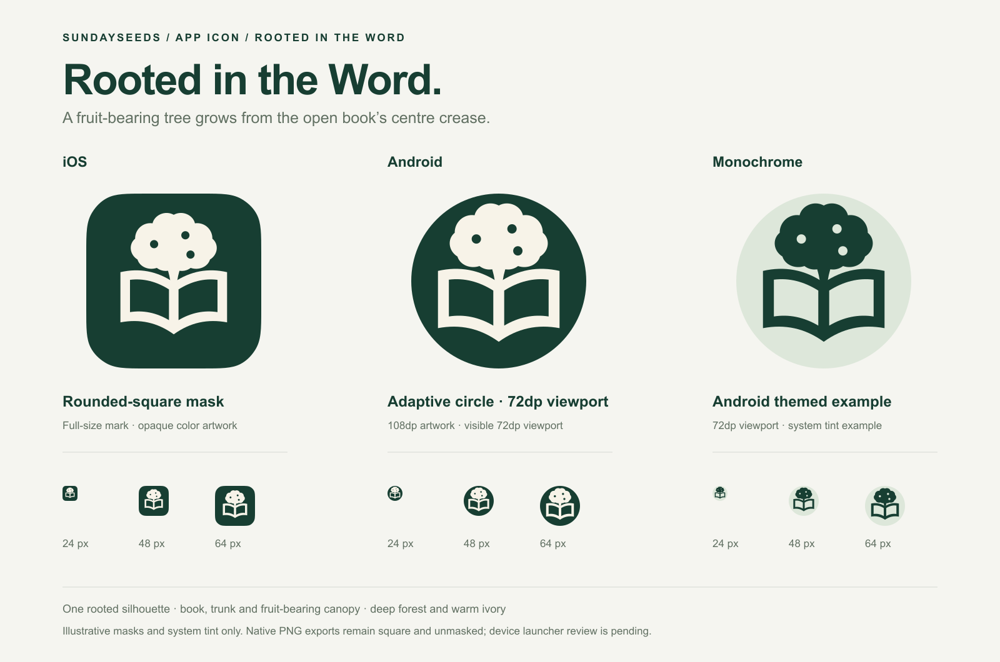
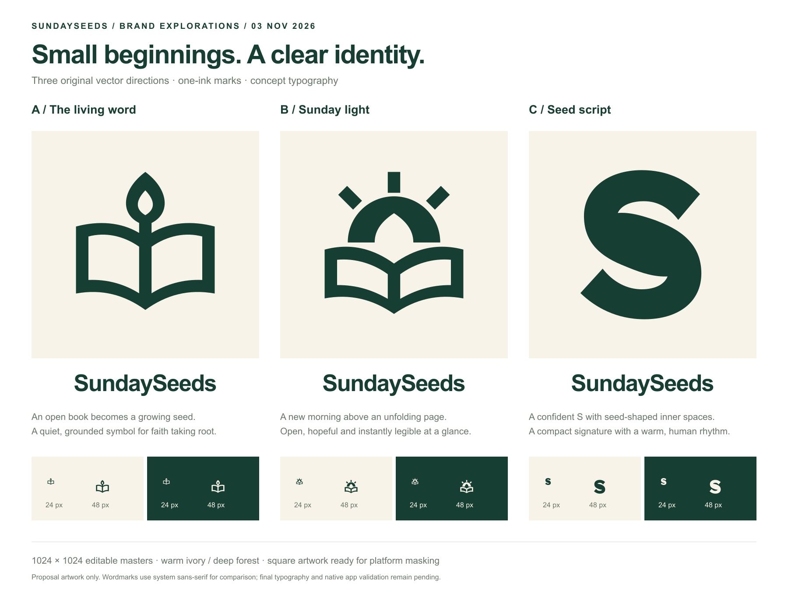

# SundaySeeds logo proposals — 3 November 2026

Three original hand-authored vector concepts explored the owner's request for a
clean, expressive app logo. After the owner requested one focused icon based on
platform design principles, the book-and-growth direction became the implemented
mark. The current revision connects the book crease to a mature tree trunk and
a broad canopy with three fruit openings. The earlier A seed/flame below is
historical; `final-preview` and the app asset master show the current revision.
This is the implementation choice, not a claim of owner visual approval.

The [editable master and export kit](../../../apps/mobile/assets/brand/README.md)
contain the actual app assets. Configuration now uses the opaque square app icon,
safe-area Android foreground, monochrome layer and favicon. The matching splash
temporarily uses the same static mark. The continuous 3D film requested later is
[pending production](../../splash-motion-direction.md). Asset rendering and source
review only; actual device/native and owner visual acceptance remain pending. The exploration below records
the earlier alternatives; B and C are not installed.

## Directions

- **A — The living word:** [SVG master](a-living-word.svg) ·
  [PNG](a-living-word.png). An open Bible grows into a single seed/flame form.
  Book spine, stem and seed share one connected silhouette. The seed-shaped
  negative space carries the growth idea without fine leaf veins or ornament.
  The clearest direct expression of learning and faith.
- **B — Sunday light:** [SVG master](b-sunday-light.svg) ·
  [PNG](b-sunday-light.png). An open page beneath a rising sun, with a seed-shaped
  opening in the sun. Three broad rays make the Sunday/daybreak idea visible.
  The most outwardly hopeful and energetic direction.
- **C — Seed script:** [SVG master](c-seed-script.svg) ·
  [PNG](c-seed-script.png). A custom S drawn from a broad curved ribbon, with
  pointed seed-shaped inner spaces. The open counters and diagonal terminals
  give it a firm silhouette. The most compact monogram-led direction.

## Deliverables

- [Comparison board SVG](comparison-board.svg) and
  [comparison board PNG](comparison-board.png): three directions with wordmarks
  and 24/48-pixel canvas samples on light and dark backgrounds.
- Each concept has an editable 1024 × 1024 SVG and matching PNG. `-dark` variants
  reverse the same single-ink mark onto forest. Geometry is unchanged.
- Deep forest `#173E32` and warm ivory `#F7F3E8`; neither the marks nor the
  imagery exploration is forced into the UI pastel palette.
- Full square canvases, with no baked rounded corners, gradients, shadows or
  effects. Primary marks occupy roughly 61–66% of the canvas height with generous
  masking clearance. The platform should apply its own icon mask.
- Wordmarks on the board use system sans-serif solely for concept comparison.
  Final typography is not selected; all symbol geometry is editable path data.
- [render-concepts.cjs](render-concepts.cjs) is the reproducible artwork source.
  It uses the existing bundled Sharp rasterizer and installs no dependencies.

## Review status

The comparison-board PNG was inspected as artwork, including light/dark samples;
an initial fill-rendering problem was corrected and the board rendered again.
This is asset inspection only. No tests, builds, app runtime, native launcher,
splash, accessibility or device visual checks have been performed. Final icon
and owner visual review remain pending. Current app assets use the revised
fruit-bearing tree; the initial A/B/C board remains an exploration record.
