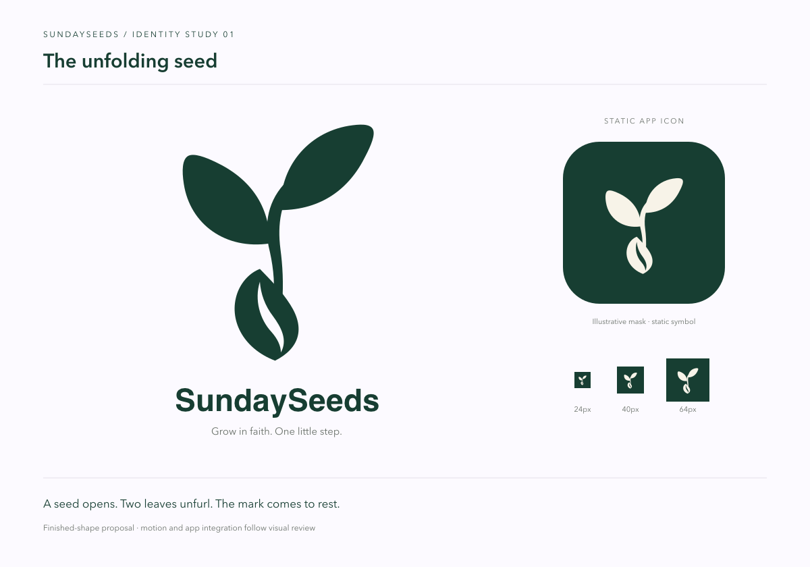

# SundaySeeds — The unfolding seed

4 November 2026. The owner selected the unfolding-seed direction after stopping
the book-to-fruit-tree film. This increment establishes the **finished shape for
visual review before animation**. Direction selection does not mean the owner has
approved this particular drawing. Current app assets remain unchanged.



## Identity

An almond-shaped seed has a curved open seam. A gently bending stem connects it
to two asymmetrical leaves: a lower, fuller left leaf and a longer rising right
leaf. Four named, editable filled paths describe the entire mark. The seed seam
is negative space, with no fine vein detail or photographic texture. The stem
ends inside the seed body without closing that seam.

Forest `#173E32` on paper `#FCFAFF`, reversed to ivory `#F7F3E8` on forest. The
wordmark uses the app's Poppins Bold. The static icon uses the symbol alone.
The concept has no book, full tree, fruit or ornamental elements. It represents
the accepted simpler direction; it does not continue the stopped 3D film.

## Files and reproduction

- `mark.svg`: original editable source, transparent 1024px square.
- `mark-preview.png`: 512px paper-background inspection image.
- `icon-concept.svg` / `.png`: unmasked, opaque square static-icon proposal.
- `board.svg`: editable board layout; `render.cjs` composites the Poppins wordmark
  into `board.png` using the existing installed font. The PNG is the complete board.
- `render.cjs`: authoring renderer using externally supplied Sharp; no app package
  was installed. Its font configuration/cache lives in ignored `.artifacts/`.

```sh
SUNDAYSEEDS_SHARP_MODULE=/absolute/path/to/sharp \
  node docs/brand-options/2026-11-04/unfolding-seed/render.cjs
```

The large icon mask on the board is illustrative. The 24/40/64px samples are
unmasked square artwork samples, not launcher captures. Platform exports,
adaptive safe-area bounds and native review follow only if this shape proceeds.

## Motion to develop after shape review

Target one restrained 2–3 second vector sequence: the seed settles into view,
the seam opens, the stem extends with a gentle curve and the two leaves unfurl
with overlapping timing. A small bending settle leads into the wordmark and the
app. The final motion geometry must match this static mark. Deform the actual
paths; do not reveal successive plant photographs or scale a complete sprout
into view as a substitute for unfolding.

Use a static final mark for reduced motion, keep an explicit load/completion
fallback and preserve the existing font/layout-gated native handoff, cleanup,
input/accessibility fencing and responsive wordmark layout. No new playback
dependency, renderer download or MCP connection is required for this proposal.
Exact motion paths, timings, implementation and owner acceptance remain pending.

## Actual review

Rendered and visually inspected the mark and board, including the small artwork
samples. Corrected an exposed stem tip and a stem overlap that interrupted the
seed seam. This is asset authoring/review only. No app code, native exports,
runtime checks, builds, typecheck, lint or tests changed or ran. Broader learner
artwork replacement and existing backend acceptance tasks remain separate.
